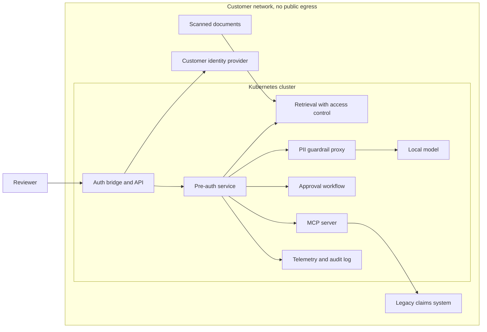
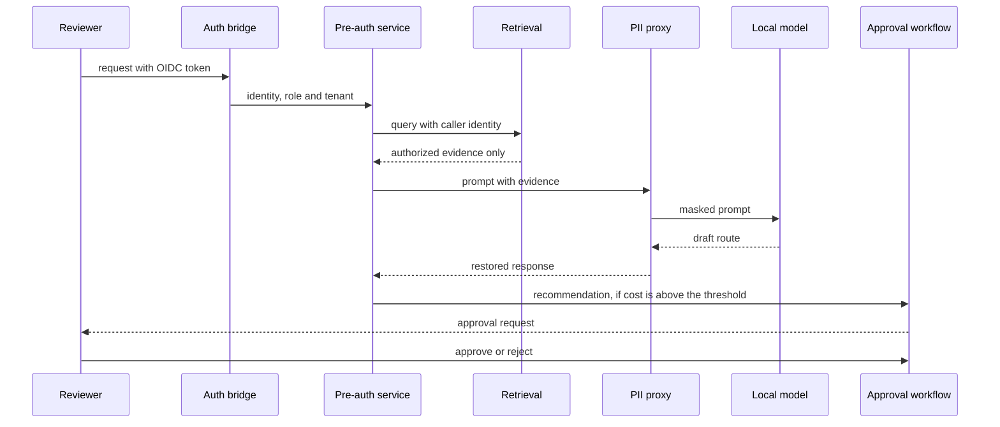

# Target architecture

This is the design the fifteen days build toward. Only the components marked **built** exist
today. Everything else is planned, with the day that builds it.

## Trust boundaries

## One request

## Components and the day that builds them

| Component | What it does | Status |
|---|---|---|
| Synthetic customer data and gold rules | Seeded generator, routing rules, access-control oracle | **Built (Day 1)** |
| Auth bridge | Validates OIDC tokens and maps groups to roles | Planned, Day 2 |
| Tenant isolation | Row-level security per tenant and role, user provisioning | Planned, Day 3 |
| Retrieval with access control | The access filter runs inside the query, so unauthorized text never reaches the model | Planned, Day 4 |
| PII guardrail proxy | Masks identifiers before a model call and restores them after | Planned, Day 5 |
| Approval workflow | Durable workflow that waits for a human above the cost threshold | Planned, Day 6 |
| Document extraction | OCR and field extraction from noisy scans | Planned, Day 7 |
| Hybrid store and ETL | Relational and vector storage with reconciliation checks | Planned, Day 8 |
| MCP server | Safe, scoped access to the simulated legacy system | Planned, Day 9 |
| Packaging | One-command install into a local cluster | Planned, Day 10 |
| Air-gapped install | Offline image bundle and an enforced egress deny | Planned, Day 11 |
| Local inference | A quantized model serving triage on one machine | Planned, Day 12 |
| Observability | Per-tenant cost, tokens and time saved | Planned, Day 13 |
| Evaluation | Golden set, shadow mode, trajectory grading | Planned, Day 14 |
| Handoff | Runbook, admin interface, chaos test, case study | Planned, Day 15 |

## Why access control lives in the retrieval query

A model that is shown a document can leak it, through a crafted prompt or through logs. So the
model is never the filter. Authorization is applied when evidence is retrieved, and the Day 4 test
asserts that a restricted document's canary string never appears in the prompt built for an
unauthorized user.
