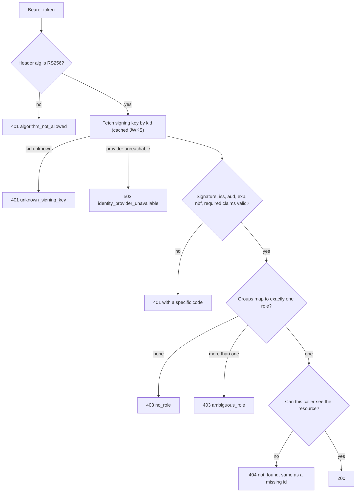

# Day 2: the OIDC auth bridge

Every later module depends on knowing who is calling and what they may read. This module is the
only place that decides that. It verifies a token from the customer's identity provider, resolves
exactly one role and region from the token's groups, and enforces access using the same oracle
(`datagen/acl.py`) that the dataset tests use.

Keycloak stands in for the customer's Okta or Azure AD. It is a real OIDC provider issuing real
signed tokens, but it is not their tenant. See "What is simulated" below.

## How a request is decided



401 means the token cannot be trusted. 403 means the token is fine but its groups give no single
role, or the role lacks the endpoint. 404 means there is no such resource for this caller, and a
resource the caller may not read looks exactly like one that does not exist. 503 means the
identity provider's keys could not be fetched, which is an outage and not a bad token.

Day 2 returned 403 for a document the caller could not read. Day 3 changed that to 404, see the
last section.

## Attacks and where each is stopped

| Attack | Defence | Test |
|---|---|---|
| Token with `alg: none` | Header algorithm checked against a pinned list before any key is used | `test_alg_none` |
| HS256 token signed with the public key as the secret | Only RS256 is accepted | `test_algorithm_confusion_hs256_signed_with_the_public_key` |
| Payload edited, old signature kept | Signature verification | `test_tampered_payload_keeps_old_signature` |
| Token signed by an attacker's own key | Key comes from the provider's JWKS, never from the token | `test_signed_by_a_different_key` |
| Token issued for a different application in the same realm | Audience must be this API | `test_wrong_audience`, `test_token_for_a_different_client_is_rejected` (real Keycloak) |
| Expired, or not yet valid | `exp` and `nbf`, with 5 seconds of skew allowance | `test_expired`, `test_not_yet_valid`, leeway tests |
| Missing `exp`, `iat`, `iss`, `aud` or `sub` | All five are required | `test_missing_required_claim` |
| Token claims `role: admin` directly | Only the groups claim is read | `test_roles_come_only_from_groups` |
| Near-miss group names (`ACME-IT-ADMINS`, `acme-um-reviewers-mars`, trailing space) | Exact match against known groups and known regions | `test_near_miss_group_names_grant_nothing` |
| User in two role groups | Refused, never first-match | `test_two_different_roles_are_ambiguous` |
| User in no role group | Refused | `test_no_groups`, real Keycloak `syn.nogroups` |
| Probing which document ids exist while signed out | 401 comes before 404 | `test_unknown_document_is_401_without_a_token` |
| Flood of tokens with random key ids to load the provider | At most one key refresh per 30 seconds | `test_a_flood_of_unknown_kids_cannot_hammer_the_provider` |

## Access matrix

Every one of the 15 synthetic users is checked against every one of the 126 documents, over HTTP,
and the result must equal the oracle. A second set of tests states expectations by hand (for
example, that an administrator sees only policies and runbooks), so a bug in the oracle cannot
hide behind a test that reuses it.

Pre-authorization requests carry clinical detail. Only reviewers (own region) and medical
directors (all regions) can read them. Claims analysts and administrators cannot.

## Run it

```bash
pip install -e ".[dev]"
pytest -q                                    # the tests that need no containers

docker compose -f infra/compose.yaml up -d   # Keycloak 26.7.5 with the acme realm imported
REQUIRE_KEYCLOAK=1 pytest -m integration -q  # 37 tests using real Keycloak tokens
python -m fde_lab.auth                       # serve the API on 127.0.0.1:8000
```

Get a token and call the API:

```bash
TOKEN=$(curl -s -X POST localhost:8080/realms/acme/protocol/openid-connect/token \
  -d grant_type=password -d client_id=fde-lab-api \
  -d username=syn.reviewer.north.1@acme.test -d password=synthetic-SYN-U-001 \
  | python -c 'import sys,json; print(json.load(sys.stdin)["access_token"])')
curl -H "Authorization: Bearer $TOKEN" localhost:8000/whoami
```

The realm file `infra/keycloak/realm-acme.json` is generated from the synthetic users. A test
fails if it drifts from the generator. To regenerate it:

```bash
python -m fde_lab.auth.realm --out infra/keycloak/realm-acme.json
```

## A bug the tests found

The first version used the JWKS client's default behaviour: cache the provider's keys for five
minutes and reject any key id not in the cache. A rotation test showed what that means in
practice. When the provider rotates its signing key, every user whose token is signed by the new
key gets a 401 until the cache expires, up to five minutes.

The fix refreshes the keys once when it sees an unknown key id. That alone would let anyone send
tokens with random key ids and make this service fetch keys from the provider on every request,
so refreshes caused by unknown ids are limited to one per 30 seconds. Both properties have tests,
and both tests fail if the corresponding half of the fix is removed.

I had also suspected the default client would refetch on every unknown key id. It does not, and
I measured that before writing a defence for a problem that did not exist.

## What is simulated

| In this lab | At a real customer |
|---|---|
| Keycloak with a generated realm | Their Okta, Azure AD or Ping tenant, which you do not control |
| The groups claim holds readable names | Azure AD puts group object ids in the claim by default, and replaces the list with a pointer when a user is in too many groups. Okta needs the groups claim configured on the authorization server. Find out on the first call. |
| Password grant, so tests can mint real tokens | Authorization code flow with PKCE. The password grant is deprecated for real use. |
| One audience, one realm | Several applications, possibly several issuers |
| Plain HTTP on localhost | TLS everywhere, terminated by their ingress |

## Known limits

- **No revocation.** A token is trusted until it expires (five minutes in this realm). A user
  disabled in the provider keeps access until their current token ends. Closing that gap needs
  token introspection or a short lifetime, and costs a provider call per request.
- **Authorization decisions are only as fresh as the token.** A user moved to a different group
  gets the old role until the next token.
- **No audit log yet.** Denials are returned but not recorded. Day 13 adds that, and it has to
  record the attempt before the query, because a hidden row and a missing row now look the same.

## Changed on Day 3

- **A hidden resource now returns 404, not 403.** This closes a limit listed here on Day 2: a 403
  on a document id confirmed the id existed. The tests now require the response for a forbidden
  id to be byte for byte the same as the response for an id that was never there.
- **The store is an interface.** `Store` (in memory, filtered by the Python oracle) and `PgStore`
  (Postgres, filtered by row-level security) both satisfy it, and a test checks that they return
  identical bodies. See [tenant-isolation.md](tenant-isolation.md).
