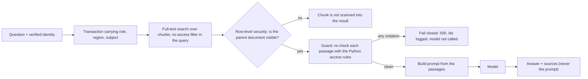

# Day 4: permission-filtered retrieval

The assistant answers questions from documents. The rule for this module is that text the caller
may not read is never retrieved, never ranked, and never placed in the prompt the model sees. The
model is not asked to ignore what it should not have been shown, because a model that has seen a
document can leak it through a crafted question or through logs.

## How a question flows



## What was built

| Piece | File | Notes |
|---|---|---|
| Chunking | `retrieval/chunking.py` | Whole sentences packed to 280 characters. Every canary lands whole in one chunk. 190 chunks from 126 documents. |
| Chunk access | `db/schema.sql` | A chunk has no access rule of its own. Its policy is "visible if its parent document is visible". |
| Search | `retrieval/pg.py` | Postgres full-text search, title weighted. The SQL has no role, region or tenant condition. |
| Query handling | `retrieval/query.py` | The question is split into words. Postgres parses each word as plain text, so input cannot become query syntax. |
| Guard | `retrieval/guard.py` | An independent check of every passage with the Python rules. Raises, never silently drops. |
| Prompt | `retrieval/prompt.py` | Numbered, titled sources. No scores or access metadata. |
| Assistant | `retrieval/assistant.py` | Retrieve, guard, prompt, model. The model is a function of the prompt string, so tests capture exactly what it saw. |
| API | `auth/app.py` | `POST /search` and `POST /ask`. Questions travel in the body, never the URL. |
| Evaluation | `retrieval/evaluate.py` | Hit rates by question kind. `python -m fde_lab.retrieval.evaluate` |

The model here is a stand-in that quotes the first sentence of the first source. Day 12 replaces
it with a local quantized model. Nothing about the access control depends on which model it is.

## Why the filter is in the query

The common design retrieves the best matches from everything and then removes what the caller may
not see. It has two problems, and both were measured here.

It leaks. Everything hidden has already been fetched, ranked and held in memory, and one
forgotten line puts it in the prompt. The tests show this: an unfiltered retriever produces
prompts containing hidden canaries for more than 90 percent of the attack questions.

It also returns less. Hidden documents occupy the top slots, and are then thrown away. Over 180
questions (nine reviewers, twenty questions each) about topics that restricted exception memos
and finance notes also discuss, at 3 results each:

| Design | Results returned |
|---|---|
| Filter in the query | 540 |
| Filter after ranking | 396 |

The post-filter design returned 27 percent fewer results to the same people asking the same
questions. A second test checks that filtering in the query returns exactly what you would get by
ranking the whole corpus, keeping what the user may read, and taking the top k, for all 15 users
across 67 questions.

## A chunk takes its access from its document

If each chunk carried a copy of its document's access rule, revoking a document would leave its
chunks readable until every copy was updated. Here the chunk table has no access columns at all
(a catalog test asserts this). Its policy asks the documents table, which asks the caller's
identity. Two tests change a document's access in the database and check that the same search
returns different results immediately, in both directions.

## Traps, and how each is handled

| Trap | Handling | Test |
|---|---|---|
| Asking for a secret by its marker, or in its own words | 2,844 such questions across 15 users, each checked against every hidden document's canary and text in the sources part of the prompt | `TestNoLeak` |
| The checker finds nothing because it is broken | Positive controls: against an unfiltered retriever the same questions do surface hidden documents, and the checker does flag the resulting prompts | `test_the_attack_questions_really_do_find_hidden_documents...`, `test_the_leak_checker_catches_a_leak...` |
| A wrong policy or a wrong database role | The guard re-checks with a different implementation and fails closed. The model is never called. | `test_the_guard_stops_an_unfiltered_retriever_before_the_model` |
| Ranking that reveals hidden documents | Scores for a shared passage are identical for a user who sees little and a user who sees everything, so hidden documents cannot shift them | `test_scores_do_not_depend_on_documents_the_caller_cannot_see` |
| Query syntax from the user | Each word is parsed as plain text. Twenty hostile inputs (operators, quotes, NUL bytes, 5,000 characters, format strings) change nothing. | `TestHostileInput` |
| Stale copies of access rules | None exist | `test_chunks_have_no_access_columns...` |
| Questions in URLs and logs | Questions are in POST bodies. The first version used a query string, and the server log recorded every question. Found by looking at the log. | `test_the_question_is_never_accepted_in_the_url` |
| The API returning the prompt | It returns the answer and source ids only | `test_ask_prompts_hold_no_hidden_text_and_responses_never_carry_the_prompt` |
| A leak caught by the guard | The response is a fixed 500. The log holds chunk ids and never the text. | `TestFailsClosedOverHttp` |

## Retrieval quality, measured

Questions are generated from the dataset: 40 policy questions (four wordings for each of ten
procedures) and one clinical-note question per note. A hit means the right document ranks within
the top k documents, and any tie with another document is counted against retrieval. Roles only
get questions whose answer they may read.

| Role (questions) | Kind | Rank 1 | Top 3 | Top 5 |
|---|---|---|---|---|
| Reviewer, north (61) | Full question | 100% | 100% | 100% |
| | Procedure name only | 100% | 100% | 100% |
| | Procedure code only | 20% | 60% | 90% |
| | Everyday paraphrase | 30% | 50% | 60% |
| | Note by request id | 100% | 100% | 100% |
| Medical director (100) | Full question, name only | 100% | 100% | 100% |
| | Procedure code only | 0% | 10% | 20% |
| | Everyday paraphrase | 30% | 50% | 50% |
| | Note by request id | 100% | 100% | 100% |
| Claims analyst, north (40) and admin (40) | Full question, name only, code only | 100% | 100% | 100% |
| | Everyday paraphrase | 40% | 60% | 60% |

What these numbers say and do not say:

- **Questions that reuse the document's words work.** This is a small synthetic corpus whose
  questions share vocabulary with the documents. It is a statement about keyword search under
  those conditions and about nothing else.
- **A bare code is ambiguous for clinicians.** The code PX-1001 appears once in the policy and
  once in each of several clinical notes. They all score the same, so the policy comes first
  only if a tie happens to be broken that way. Roles that cannot read notes see no ties and get
  100 percent. A test records this as a known limit.
- **Paraphrases mostly fail.** I wrote ten everyday paraphrases once and did not change them
  afterwards. Four share no word at all with the procedure name, and for those retrieval returns
  only generic matches. Most of the apparent hits come from one incidental shared word, such as
  "knee", "sleep" or "arthritis". Semantic matching is the job of the vector index on Day 8.

## What the evaluation found

1. **A tokenizer mismatch.** The first query builder split `PX-1001` into `px` and `1001` itself.
   Postgres indexes that string as `px` and `-1001` (with the minus sign), so the query matched
   almost nothing: 10, 30 and 50 percent at ranks 1, 3 and 5 for a reviewer. The fix is to hand
   each whole word to Postgres so the query is parsed the way the index was.
2. **A flattering metric.** After that fix every score was 100 percent, which was too neat. The
   first metric ranked chunks, and broke ties by chunk id, which happened to favour the right
   document. I made it stricter after seeing the result: it ranks documents and counts any other
   document that ties with the right one as ahead of it. My first stricter version had its own
   bug, because it counted a document's second chunk as a competitor to the document itself. I
   found that by looking at the supposed misses and fixed it. The numbers above use the final
   metric. It made the code-only and paraphrase rows lower, and it is the reason the bare-code
   limit is documented at all.
3. **Untested evaluation code.** Two mutations of the metric (ties no longer counted, rank off by
   one) passed the whole suite. The metric has unit tests now, and both mutations are caught.

## Tests and mutation check

256 tests need nothing but Python. The database job runs 390 against a real Postgres (Day 3's
suite plus this day's), including the 2,844-question no-leak matrix, the correctness check against the full ranking, and
the HTTP tests.

I broke the code in 15 ways and required the suite to catch each one: a chunk policy that shows
everything or unlocks all chunks on any visible parent, row security switched off on chunks, a
guard that never denies or silently drops, an assistant that skips the guard, a prompt that leaks
access metadata, the original hand-split tokenizer, a search with no identity, a chunker that
drops its last chunk, an API that returns the prompt, unordered ties, a wrong limit, and two
mutations of the evaluation metric. All 15 are caught.

## Run it

```bash
pip install -e ".[dev]"
docker compose -f infra/compose.yaml up -d --wait postgres
python -m fde_lab.db                         # roles, schema, dataset and chunks
python -m fde_lab.retrieval.evaluate         # the table above
REQUIRE_POSTGRES=1 pytest -m db -q
```

## What this does not do

- **Keyword matching only.** Paraphrased questions mostly fail, as measured above.
- **No relevance threshold.** If any word matches, something is returned. Declining to answer when
  the sources do not help is left to the model, and the stand-in model does not do it. A question
  about restricted material from a role that cannot see it gets an unrelated but harmless answer.
  Measuring abstention is part of Day 14.
- **Clinical notes contain names and phone numbers.** A reviewer may read them, so they reach the
  prompt. Masking them before any model call is Day 5.
- **Instructions inside documents are not defended against.** The prompt tells the model to treat
  sources as reference material. That is a request, not a guarantee.
- **There is no answer cache, and it must not be keyed by question alone.** A cache that returns
  one user's answer to another would bypass everything above. Any cache has to include the
  caller's identity in its key.
- **Index use under row security is unmeasured.** Whether Postgres uses the text index when
  policies apply was not checked. With 190 chunks it does not matter, and at scale it could.
- **English and ASCII only.** The text search configuration is English.

## What is simulated

| In this lab | At a real customer |
|---|---|
| Postgres full-text search over 190 chunks | Their search platform or a vector store, possibly with its own idea of permissions that must be reconciled with the identity provider's |
| A stand-in model that quotes the first source | A model whose behaviour on weak or missing evidence has to be measured |
| Synthetic questions that reuse document wording | Real reviewer questions, collected with their consent |
